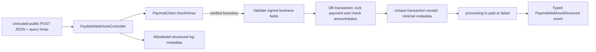

# Webhook security review

Reviewed 2026-10-26. Base: `1762b8cc23a58a7a13261c6e7385a54322052333`.
Scope: local fixtures only; no Paymob credentials or live payment requests.

## Assets and boundary

Assets: payment status/amount/reference, capture authority, merchant credentials,
customer privacy, durable replay receipts, and application event consumers.
An attacker can POST arbitrary JSON, query parameters and headers, alter unsigned
fields, replay a captured callback and race concurrent deliveries. The attacker
is assumed not to know the configured HMAC secret or control the database.



## Signature trace

`src/Routes/paymob.php` registers the configured POST path. The controller reads
JSON directly; query parameters may supply only `hmac`. Verification occurs
before validation, logs, lookup, receipt writes, events or payment changes.
`PaymobClient::checkHmac` requires a configured nonempty secret and scalar signed
fields, then computes HMAC-SHA512 and uses `hash_equals`.
The protocol concatenates these values without separators in this exact order:

```
amount_cents, created_at, currency, error_occured, has_parent_transaction,
id, integration_id, is_3d_secure, is_auth, is_capture, is_refunded,
is_standalone_payment, is_voided, order.id, owner, pending,
source_data.pan, source_data.sub_type, source_data.type, success
```

Booleans are lowercase `true`/`false`; no raw-body hash or arbitrary JSON sorting.
Reference: [Paymob transaction callbacks](https://developers.paymob.com/paymob-docs/developers/webhook-callbacks-and-hmac/transaction-callbacks).
The separate HMAC calculation page was unavailable during review; the ordered
fixture is independently concatenated in tests. Provider interoperability still
requires sandbox acceptance before production use.

## Findings

| Severity / finding | Evidence and attack precondition | Impact | Fix | Residual risk |
|---|---|---|---|---|
| High: implicit capture of successful notifications | Original controller dispatched ProcessPaymobPayment for any success and processing reference; requires a valid callback, including a replay or a standalone/capture notification | Unintended financial API call and inconsistent references | Remove automatic capture from webhook; only update a matching local payment with equal amount under row lock | Explicit capture API/job remains caller-controlled; reconcile ambiguous remote capture outcomes before retry |
| High: unsafe business notification and terminal transitions | Original controller emitted paid event before checking payment; valid unknown, pending, refunded or voided callbacks could reach fulfillment listeners | Premature fulfillment, duplicate business effects | Reject unknown references and mismatched amounts; suppress pending/error/refund/void and terminal-state notifications; update only processing rows | Single terminal outcome per transaction; subsequent refunds/reversals require separate reconciliation; application must bind correct currency and merchant integration when creating local payment |
| High: replay race | Original recordWebhookEvent used exists then create; simultaneous valid deliveries race | Duplicate-request failures and unreliable processing | Unique transaction_id plus createOrFirst; receipt, state change and synchronous event run in one DB transaction | No exactly-once guarantee for external listener effects; use transactional outbox/idempotent listeners; production DB concurrency not exercised by SQLite fixtures |
| Medium: sensitive payload persistence/logging | Original receipt persisted original request including hmac and personal data; include_payloads enabled arbitrary request logging | Customer data/credential exposure to DB or log readers | Persist only IDs, amount and success; never log webhook payloads; redact entire outbound payload/message contexts | Purge historical records/logs according to retention policy; host access logs, APM, exception previous chains and application listeners need independent controls |
| Medium: signature boundary ambiguity | Original validation used combined request input before verification; missing signed fields normalized to empty strings | Malformed input ambiguity and logging before trust established | JSON-only business input; scalar signed fields; missing/invalid signatures return 403 before side effects | HMAC protocol itself signs selected fields only; never trust additional payload data |

No committed production credential was identified in scoped package/configuration
files. `config/paymob.php` reads environment-backed secrets; responses contain only
fixed messages. Public client credential/config accessors remain server-side APIs:
do not serialize the client, config, authentication DTO or payment-key DTO to logs.
Never enable APP_DEBUG in production. Empty HMAC fails closed.

## State and delivery semantics

Persist a processing Payment with paymob_reference equal to the Paymob order ID
and the expected integer amount before accepting callbacks. Unknown references
return 404, amount mismatches 409, invalid signatures 403, malformed verified
business fields 422. Replays/unsupported statuses return 200 without events.
A first terminal callback records one receipt and changes processing to paid or
failed. It never creates a capture job. Synchronous listener exceptions roll back
the DB transaction; listeners must avoid irreversible effects before commit.
Use after-commit queued listeners with their own idempotency/outbox for fulfillment.

## Verification

PHP 8.4.25; local SQLite/Testbench. Regression cases cover valid, missing, invalid,
modified and repeated callbacks, minimal persistence, terminal-state protection,
amount mismatch and absence of capture jobs. Full package suite and quality checks
are recorded in the branch commit workflow. No production DB concurrency claim,
no live integration or provider signature vector validation is made.
